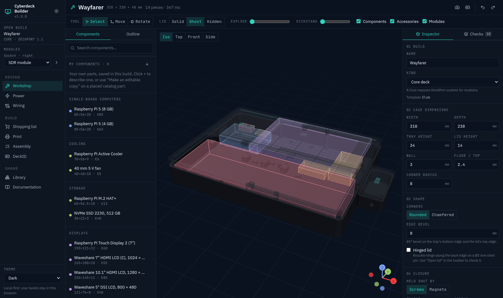

# Cyberdeck Builder

Design modular cyberdecks in the browser, from the electronics to a printable case.



- **Place real components** in 3D (Raspberry Pi 5 catalog, plus your own parts) and move or rotate them along X, Y and Z.
- **Formats**: slab, tactical, briefcase, suitcase, field case, handheld, DeckPort module and rail module; rounded or chamfered outlines, bevels, knuckle hinge, screw or magnet closure.
- **Shape the case** with cut, extrude, colour inlay, boss and text on any face, with patterns.
- **Accessories**: Picatinny rails, block or knurled tube handles, feet, kickstand, sliding screen carriage, cable glands, TPU grommets and tie points.
- **Modules**: the DeckPort interface (pogo or USB-C socket, or Picatinny rail clamp) so modules designed later fit the Core you print now; modules are shown mounted and counted in the Core's power budget.
- **Live checks**: fit, collisions, power, ports, heat, printability, loose bits.
- **Print it**: bed-fit splitting with heat-set insert joints, plate layout with time estimates, multi-colour 3MF, STL and STEP export.
- **Build it**: shopping list with your prices, wiring diagram, and an assembly guide with a 3D simulation.
- **Local-first**: builds stay in your browser; share them as files or self-contained links.

The UI uses the design system of [Remora](https://github.com/Ch4rybd3/Remora).

## Run

```sh
npm install
npm run dev      # http://localhost:5173
npm test
npm run build    # static site in dist/
```

## Documentation

Everything is in [`docs/`](docs/index.md), and the same pages are rendered under **Documentation** in the app.

## Checks

`npm run check` runs lint, typecheck and tests, the same as CI (`.github/workflows/ci.yml`) on every push and pull request.

## Deploy

`.github/workflows/pages.yml` builds and publishes to GitHub Pages. It is **manual for now**: run it from the Actions tab. Before the first run, set **Settings → Pages → Source** to *GitHub Actions*. The build uses relative paths and hash routing, so it also works unchanged on a custom domain.

## Licence

The code is under the MIT licence (see `LICENSE`). Each deck design carries its own licence, chosen on its DeckID card; the default is CERN-OHL-S-2.0.
