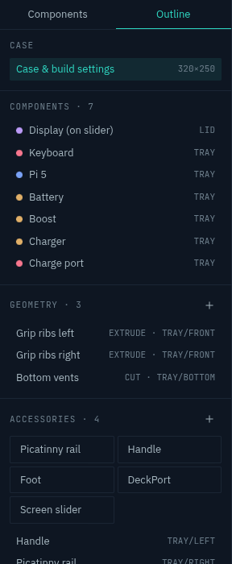
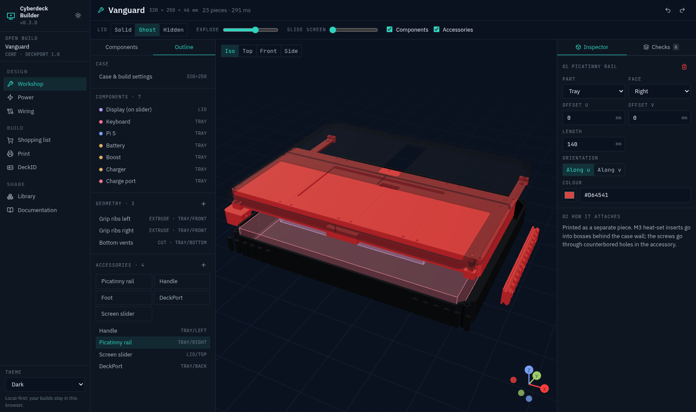

# Accessories

Accessories are **separately printed parts** that bolt onto the case. The case gets M3 heat-set inserts in bosses behind its wall; the accessory gets counterbored clearance holes. The accessory comes off with a hex key, without touching the case.

| Accessory | Size | Fixing |
|---|---|---|
| **Picatinny rail** | 21.2 mm wide, your length | M3 screws on the lands between slots, at both ends (plus the middle from 120 mm) |
| **Handle** | 20 × 32 mm section, your length (min. 80 mm) | 4 × M3, two in each foot |
| **Foot** | Ø18 × 5 mm | 1 × M3, add a rubber bumper |
| **DeckPort** | 40 × 20 mm socket or plug | 4 × M3, see [DeckPort](./deckport.md) |
| **Screen slider** | Sized from its display | See [Screen slider](./slider.md) |

## Placing a Picatinny rail, step by step

1. In the **Workshop**, open the **Outline** tab in the left rail.
2. Next to **Accessories**, click **+** and choose **Picatinny rail**. The rail appears on the tray's left face and the Inspector opens on it.
3. In the Inspector, set:
   - **Part**: *Tray* or *Lid*.
   - **Face**: the side it goes on. *Left*, *Right*, *Front* and *Back* are the usual choices; *Top* on the lid makes a rail for a light or a camera.
   - **Offset u / v**: where the centre of the rail sits on that face, from the face centre. u runs left to right and v bottom to top, as seen from outside that face (see [Case geometry](./case-geometry.md#placement-on-the-face)).
   - **Length**: in mm. Slots are cut every 10.01 mm, so a length that is a multiple of 10 plus 4 gives clean ends (54, 104, 144…).
   - **Orientation**: *Along u* lays the rail horizontally on the face, *Along v* vertically. A vertical rail needs a face at least as tall as the rail is long.
   - **Colour**: the rail is its own body, so it can be another filament.
4. Pull the **Explode** slider in the toolbar to see the rail lift off the case with its screw holes.

Check the face height: the tray's side faces are only *Tray height* tall, so a rail along v on a 34 mm tray is limited to about 30 mm. The rail's base is 21.2 mm wide, and the M3 bosses behind the wall need about 8 mm of clear space inside the case. The **Checks** tab reports a component that collides with them.

### Printing a rail

Print it **base down**. The 45° dovetail flanks print without supports. Test-fit a short rail (54 mm) with your accessory first: the profile is a simplified MIL-STD-1913 and every printer's tolerances differ. If the fit is tight, scale the rail by 101% across its width in the slicer.

### Attaching it

1. Press one M3 heat-set insert into each boss on the case (220 °C for PLA, 240 °C for PETG).
2. Hold the rail on the face and drive M3 × 6 screws (see the Shopping list for the exact length) through its counterbored holes.

## Handles and grips

The handle is a U shape bolted on with four screws. On the **Tactical** format it sits on the left face as a side grip; on the **Briefcase** and **Suitcase** formats it is on the front face of the tray, so the case hangs hinge-up when carried.

## Feet

Four feet on the bottom face are added by most formats. Each takes one M3 insert in a boss above the floor. Stick a rubber bumper on top of each foot.
