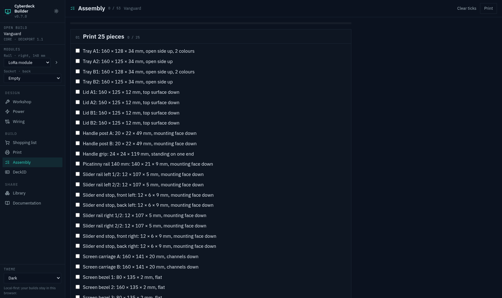

# Assembly guide

The **Assembly** page (under *Build* in the sidebar) turns the open build into a step-by-step guide. It is generated from the build and the case that will actually be printed, so it changes when you change the printer, a joint, a handle or a module.

| Step | What it lists |
|---|---|
| Print | Every piece with its size, print orientation and colours |
| Inserts | Heat-set inserts by size and where they go |
| Join | Split joints, if the case was cut for the bed |
| Accessories | Rails, handles (including the tube handle bolt), feet, DeckPort connectors, the screen slider in the order it must go together |
| Electronics | Each component, where it goes and how it is held |
| Wiring | Every power, data and signal wire from the Wiring page, with its gauge |
| Modules | How each attached module mounts: socket screws, or rail clamp, cross bolt and cable |
| Close | Hinge pin, magnets (with their polarity) or closure screws |

Tick items off as you go. The ticks are kept in this browser only, per build, and **Clear ticks** starts over. **Print** gives a paper copy.
