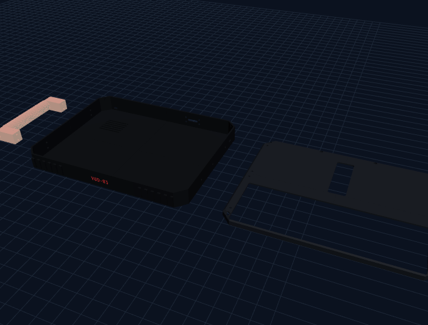

# Assembly guide

The **Assembly** page (under *Build* in the sidebar) turns the open build into a step-by-step guide. It is generated from the build and the case that will actually be printed, so it changes when you change the printer, a joint, a handle or a module.

| Step | What it lists |
|---|---|
| Print | Every piece with its size, print orientation and colours |
| Inserts | Heat-set inserts by size and where they go |
| Join | Split joints, if the case was cut for the bed |
| Accessories | Rails, handles (including the tube handle bolt), feet, DeckPort connectors, the screen slider in the order it must go together |
| Electronics | Each component, where it goes and how it is held |
| Wiring | Every power, data and signal wire from the Wiring page, with its gauge |
| Modules | How each attached module mounts: socket screws, or rail clamp, cross bolt and cable |
| Close | Hinge pin, magnets (with their polarity) or closure screws |

## Simulation

Beside the checklist, a 3D view plays the assembly. It follows the **focused** item, the one highlighted in the list:

- everything installed by earlier items is in place;
- the focused item's parts are highlighted and loop through their motion: components **drop** into the case, accessories and modules **slide** on along their face, split pieces **come together**, and the lid **closes** (on its hinge, or from where it waits beside the tray);
- parts installed by later items are not there yet.

**Done, next** ticks the focused item and moves on to the next open one; ticking an item in the list does the same. **Previous** and **Skip** move without ticking, and clicking any item shows it. Orbit the view with the mouse as in the Workshop.

The ticks are kept in this browser only, per build, and **Start over** clears them.

## Printing

**Print** gives a paper copy of the checklist over as many pages as it needs, in the light palette, without the sidebar or the 3D view. The Shopping list and the DeckID card print the same way.
