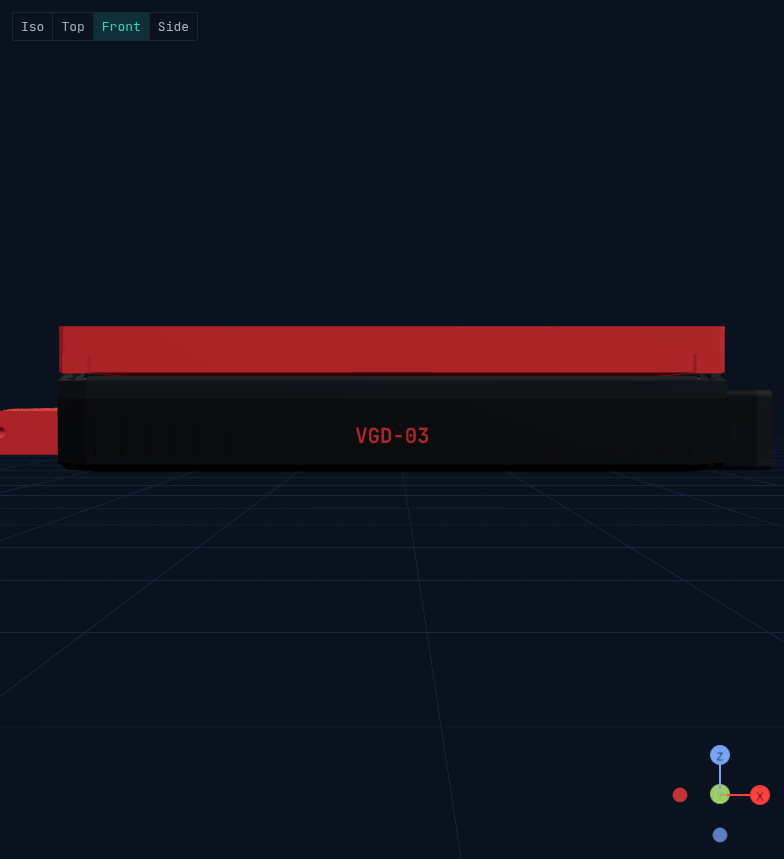

# Case geometry

The case is generated from the build every time it changes. It runs entirely in the browser using [Manifold](https://github.com/elalish/manifold), a robust mesh boolean kernel compiled to WebAssembly.

## Parts

A case has two parts:

- **Tray**: the bottom shell, open at the top. Height = *Tray height*, base thickness = *Floor / top*.
- **Lid**: the top shell, open at the bottom. Height = *Lid height*, top plate thickness = *Floor / top*.

Both share the outline: *Width* × *Depth* with *Corner radius*, and *Wall* thickness.

## What is generated automatically

| Element | Rule |
|---|---|
| Closure | Bosses in the tray corners (and along the long edges when *Screws* > 4). With screws: heat-set inserts in the tray and counterbored clearance holes in the lid. With magnets: Ø6.2 × 3.2 mm pockets in both bosses. A hinged case only uses the front positions. |
| Hinge | Alternating knuckles on the tray and the lid along the back edge, Ø10 mm, 0.5 mm gaps, with a Ø3.2 mm pin hole through all of them. Each part gets clearance cut around the other's knuckles. |
| Standoffs | Under every board with mounting holes, when *Standoffs* is on: a boss with a heat-set insert at the board's hole pattern (Pi 5: 58 × 49 mm, M2.5). Standoffs shorter than 3 mm become clearance holes through the floor instead. |
| Windows | Screens, keyboards, ports and switches define windows. A *top* window is cut through the lid; a side window is cut through the wall the component faces after rotation. |
| Accessory mounts | Every accessory adds heat-set insert bosses behind the case wall. |
| Split joints | See [Printing](./printing.md). |

## Geometry features

Features are basic modelling operations on one face of one part. Add them from **Outline → Geometry → +**.

| Operation | Effect |
|---|---|
| **Cut** | Removes material inward from the face. Depth 0 means "through the wall". |
| **Extrude** | Adds material outward from the face. A colour different from the part makes it a separate body. |
| **Inlay** | Cuts a shallow pocket (default 0.6 mm) and fills it with a separately coloured body: logos, stripes and labels in a second filament. |
| **Boss** | Adds material inward, behind the wall, such as a mount for something that has no catalog entry. |

### Sketch

Every operation extrudes a 2D sketch:

- **Rect**: width, height, corner radius.
- **Circle**: diameter.
- **Slot**: length and width, with rounded ends. Good for vents.
- **Polygon**: a list of `u,v` points.
- **Text**: a label in JetBrains Mono Bold or IBM Plex Sans SemiBold (the Remora fonts). *Cap height* sets its size in mm.

### Text labels

Text works with every operation. **Inlay** prints the letters in a second colour flush with the surface. **Cut** with a depth of 0.6 mm engraves them, and **Extrude** embosses them. Outline → Geometry → + offers *Text label (inlay)* and *Engraved text* as starting points.

Keep the cap height at **4 mm or more** on a 0.4 mm nozzle: strokes thinner than about 0.8 mm do not print. Labels read correctly from outside the face they are on. On the lid top, which prints upside down, an inlay prints in the first layers, so it is crisp and needs a single filament swap on a single-extruder printer.

### Placement on the face

Each face has its own 2D axes, as seen from outside the case:

| Face | u (left → right) | v (bottom → top) |
|---|---|---|
| Top | +X | +Y |
| Bottom | +X | −Y |
| Front | +X | +Z |
| Back | −X | +Z |
| Right | +Y | +Z |
| Left | −Y | +Z |

*Offset u / v* move the sketch from the face centre. *Rotation* turns it on the face.

### Staying on the wall

An **extrude** feature is trimmed to the **flat part of its face**: on a rounded or chamfered case, ribs or pads that run onto the corner would hang in the air, so the part past the flat is cut off and the Checks tab says so. Bevelled edges count too: on a bevelled tray the bottom of each side is not flat.

The generator also checks every printed piece for **loose bits**: solids that touch nothing else, which would come off the bed as separate fragments. When it finds one, the Checks tab names the piece and its volume.

### Patterns

*Count u × Count v* repeats the sketch on a grid, centred on the offset, with *Pitch u / v* spacing. A vent block is a slot with *Count v = 6, Pitch v = 8*.

## Shape, hinge and closure

Chamfered corners, edge bevels, the knuckle hinge and magnet closure are described in [Formats](./formats.md#shape-options).

## Accessories

Rails, handles, feet, DeckPort and the screen slider are separate printed parts. See [Accessories](./accessories.md) and [Screen slider](./slider.md).
