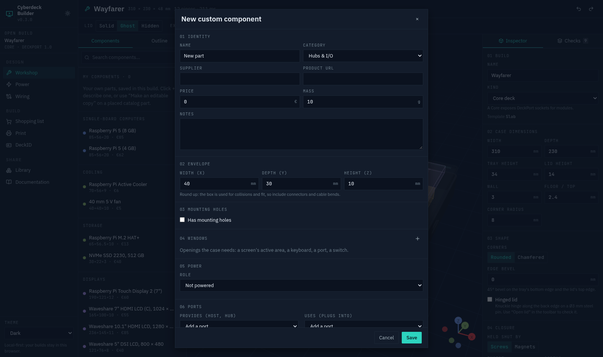

# Custom components

The catalog cannot list every part. A **custom component** describes your own: a display, a keyboard PCB, a radio module, a battery pack. It is saved **inside the build**, so share links and `.cyberdeck.json` files carry it, and whoever opens your build sees the same part.

## Creating one

There are two ways:

- **From scratch**: in the Workshop's *Components* tab, click **+** next to *My components*.
- **From a catalog part**: place it, then click **Make an editable copy** at the bottom of its Inspector. The placement switches to the copy, which records the original in `basedOn`. Use this when a part is almost right: a different screen bezel, a keyboard with a knob, a battery of another capacity.

Click a custom component in *My components* to place it, or the pencil next to it to edit it.

## What you describe

| Section | Fields | Used by |
|---|---|---|
| Identity | Name, category, supplier, URL, price, mass, notes | Shopping list, DeckID, wiring colours |
| Envelope | Width, depth, height (mm) | Fit and collision checks, the viewport, joint placement |
| Mounting holes | Insert size, hole centres, standoff height | Standoffs with heat-set inserts in the case |
| Windows | Face, size, offset | Openings cut in the lid or the wall the component faces |
| Power | Load, battery, converter or charger, with its numbers | Power budget, autonomy, wiring |
| Ports | What it provides (a hub, a HAT) and what it plugs into | Port check, data wires |

### Mounting holes

Hole centres are relative to the **centre of the component**, in its own orientation before any rotation. The *Pattern* helper fills in four holes on a rectangle: enter the hole spacing (e.g. 58 × 49 mm for a Raspberry Pi) and, if the pattern is off-centre, its offset. Then click **Apply**. You can also type the list directly as `x,y; x,y; …`.

### Windows

A window on the *top* face is cut through the **lid** (screens, keyboards, buttons). A window on a side face is cut through the case wall that side faces after rotation (ports, switches, speakers). The component must sit against that wall for the opening to line up; the Checks tab tells you when it does not.

### Rounding up

The envelope is a box. Include connectors, cables and their bend radius, otherwise the fit check will be optimistic.

## Deleting

A custom component used by a placement cannot be deleted: remove or swap the placements first.

## Sharing a part with everyone

A part that would help others belongs in the built-in catalog. Open a pull request that adds it to `src/catalog/components.ts` (see [Component catalog](./catalog.md)).
