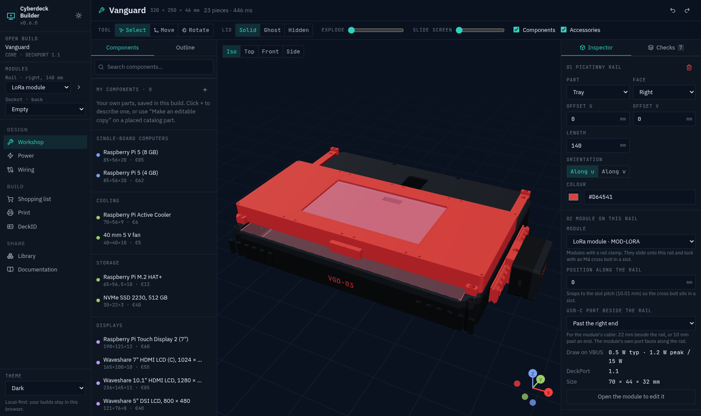

# DeckPort specification

**Version 1.1**

DeckPort is the interface between a **Core** deck and its **modules**. A module that implements DeckPort 1.x fits any Core that offers the matching mounting point. The numbers below come from `src/domain/deckport.ts`.

DeckPort 1.1 defines three ways to connect:

| Profile | Core side | Module side | Electrical |
|---|---|---|---|
| **Direct, pogo** | DeckPort socket (recess, 4 × M3 inserts, connector window) | DeckPort plug (key, 4 screws) | 8-pin pogo: 5 V, USB 2.0, I²C, ID, VBAT |
| **Direct, USB-C** | DeckPort socket with a USB-C receptacle | DeckPort plug with a USB-C male plug | USB-C: 5 V / 3 A, USB 2.0 |
| **Rail** | Picatinny rail + a USB-C port beside it or past its end | Printed rail clamp + USB-C receptacle on the module's end | Short USB-C cable: 5 V / 3 A, USB 2.0 |

All three share the same power budget: **15 W per mounting point** (5 V, 3 A).

## Direct mount (socket and plug)

| Item | Value |
|---|---|
| Module grid unit | **20 mm**. Module footprints are whole multiples (2U × 2U = 40 × 40 mm). |
| Socket footprint | 2U × 1U = **40 × 20 mm** on any face of the Core |
| Fixing | Four **M3 heat-set inserts** in the Core at (±15, ±5) mm from the socket centre |
| Screws | From the inside of the module, through Ø3.4 clearance holes, into the Core inserts |
| Alignment | **36 × 14 × 1.0 mm** recess in the Core; the module has a 35.6 × 13.6 × 0.8 mm key |
| Connector window | Pogo: **22 × 5.5 mm**. USB-C: **9.4 × 3.6 mm** receptacle in the Core, **12.6 × 6.8 mm** window for the plug overmould in the module |

The key-and-recess pair locates the module to within ±0.2 mm before the screws go in, so the pogo pins land on their pads, or the USB-C plug finds its receptacle.

### Pogo pinout (8 pins, 2.54 mm pitch)

| Pin | Name | Function |
|---|---|---|
| 1 | VBUS | 5 V regulated, **3 A max** per socket (15 W) |
| 2 | GND | Ground |
| 3 | D+ | USB 2.0 data +, from a Core USB port or hub |
| 4 | D− | USB 2.0 data − |
| 5 | SDA | I²C data, 3.3 V logic |
| 6 | SCL | I²C clock, 3.3 V logic |
| 7 | ID | Module identification: 1-Wire EEPROM, or an ID resistor to GND |
| 8 | VBAT | Raw battery rail, optional, fused at 3 A on the Core side |

A magnetic pogo pair is recommended: female pads on the Core, spring pins on the module.

### USB-C option

| Signal | Use |
|---|---|
| VBUS | 5 V, 3 A max (15 W), sourced by the Core |
| GND | Ground |
| D+ / D− | USB 2.0 data |
| CC | Core: **10 kΩ pull-up** to 5 V (advertises 3 A). Module: **5.1 kΩ pull-down** (sink) |
| SBU1 / SBU2 | Optional SDA / SCL, only with full-featured cables; otherwise unused |

USB-C trades the I²C bus, the ID pin and VBAT for a connector you can buy anywhere, a reversible plug and standard cables. A module identifies itself by USB enumeration instead of the ID pin. Use breakout boards with the CC resistors already fitted.

## Rail mount

| Item | Value |
|---|---|
| Rail | MIL-STD-1913 Picatinny rail on the Core (a bolt-on accessory), slots every **10.01 mm** |
| Clamp | **40 × 36 mm**, printed separately and screwed to the module with 4 × M3 into inserts. Slides onto the rail from one end. |
| Lock | **M4 × 40** cross bolt and nyloc nut across the clamp, sitting in a rail slot. Module positions snap to the slot pitch. |
| Standoff | The module face sits **13 mm** off the Core face |
| Connector | USB-C receptacle on the **module's end**, facing along the rail; USB-C port on the Core **beside the rail** (22 mm off its centre line) or **past one end** (10 mm) |
| Cable | 10 cm USB-C to USB-C, right-angle, USB 2.0 is enough |

The jaws stop 2.3 mm above the Core face, so they clear the rail's base plate. Put the clamp on the module's **largest face**, usually the bottom.

## Rules

- The Core feeds every mounting point that has a module from one of its USB ports. A socket always reserves one; a rail reserves one when it has a port. The port check counts them.
- The Core should place a **polyfuse or load switch** on each VBUS.
- A module must draw no more than **15 W**. The checks enforce it.
- VBAT (pogo only) is optional. A module must not back-feed VBAT.
- On a direct mount, the connector must match: a pogo plug does not go in a USB-C socket.

## Logical

A module is a build with `kind: "module"`. It records the DeckPort version it implements (`deckport: "1.1"`). It may name the Core it was designed for (`targetCore`). Its plug is a DeckPort accessory with a `mount` (`direct` or `rail`) and a `connector` (`pogo` or `usb-c`).

### Versioning

- **Minor** versions only add things and stay compatible. 1.1 added the USB-C connector and the rail mount; every 1.0 module still fits a 1.1 Core.
- A **major** version (2.0) may change the footprint or the pinout. Cores and modules record the version they implement, and the app warns about a mismatch.
