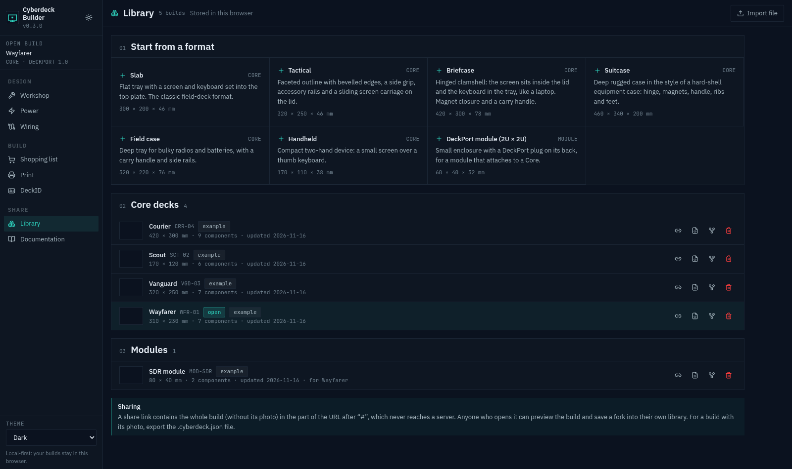
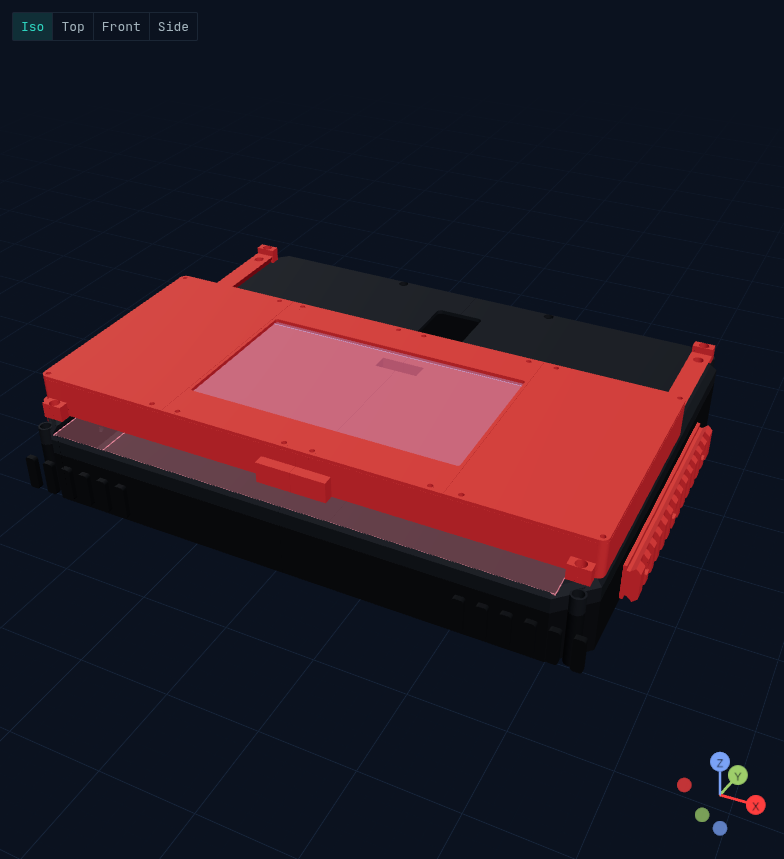
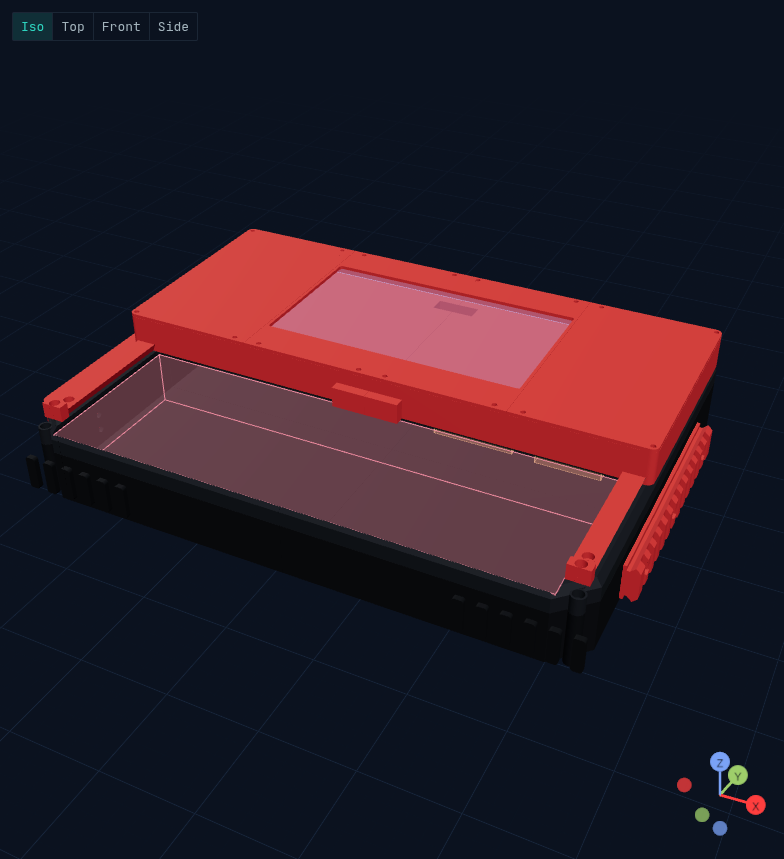
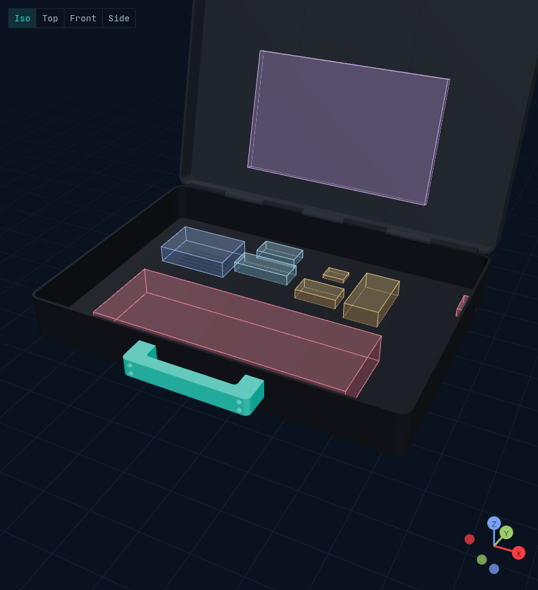
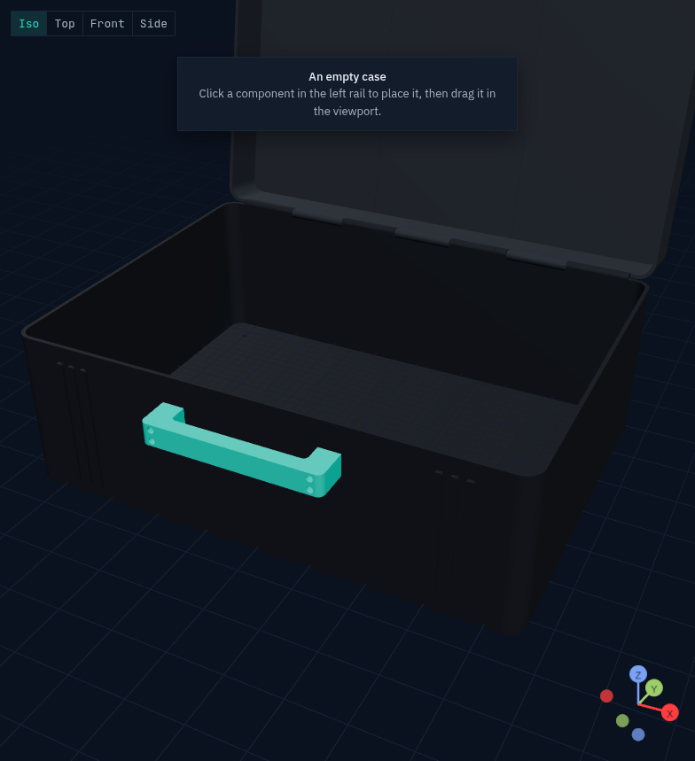
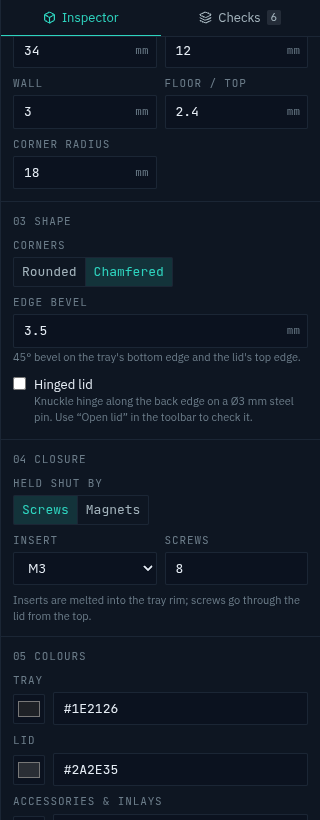

# Formats

A format is a starting point: case dimensions, shape options and a few accessories. Pick one under **Library → Start from a format**. Everything stays editable afterwards.

| Format | Size (W × D × H) | Shape | Lid | Notes |
|---|---|---|---|---|
| Slab | 300 × 200 × 46 | Rounded | Screwed | The classic flat deck |
| **Tactical** | 320 × 250 × 46 | Chamfered + 3.5 mm bevel | Screwed | Side grip, rail, **screen slider**, grip ribs |
| **Briefcase** | 420 × 300 × 78 | Rounded | **Hinged, magnets** | Laptop-style, handle on the front |
| **Suitcase** | 460 × 340 × 200 | Rounded + 2 mm bevel | **Hinged, magnets** | Rugged hard-case style, ribs, handle, feet |
| Field case | 320 × 220 × 76 | Rounded | Screwed | Deep tray, handle and two rails |
| Handheld | 170 × 110 × 38 | Rounded | Screwed | Small two-hand device |
| DeckPort module | 60 × 40 × 32 | Rounded | Screwed | A module for a Core |

## Tactical

A faceted deck in the spirit of military field terminals: chamfered corners, bevelled edges, grip ribs on the front, a side grip on the left and an accessory rail on the right. The screen rides on a [sliding carriage](./slider.md): closed, it covers and protects the keyboard; open, it slides back and uncovers it.

The example build **Vanguard** uses this format with a Pi 5, a 60% keyboard and the 7" Touch Display 2 on the slider.

## Briefcase

A clamshell that opens like a laptop. The lid turns on a **knuckle hinge** along the back edge, on a Ø3 mm steel pin, and is held shut by **magnets** at the front. The display goes in the lid facing inward (its *window* is off, so the lid top stays closed), and the keyboard goes in the tray.

Use **Open lid** in the Workshop toolbar to swing the lid and check that nothing in the lid hits the tray. The example build **Courier** carries a 10.1" display, a 60% keyboard, an RTL-SDR and a LoRa radio.

## Suitcase

A deep, rugged case in the style of hard-shell equipment cases: 150 mm tray, hinged 50 mm lid, ribs on the front and back, a handle and four feet. Its size suits big batteries, radios, a full-size keyboard or a mini-PC. On a 220 mm bed it splits into many pieces; see [Printing](./printing.md).

## Shape options

Every format can use them. Select **Case & build settings** in the Outline, then the **Shape** section:

| Option | Effect |
|---|---|
| **Corners: Rounded / Chamfered** | Rounded uses *Corner radius* as a radius. Chamfered cuts the corners at 45°, with *Corner radius* as the chamfer size: an octagonal, faceted outline. |
| **Edge bevel** | A 45° bevel on the tray's bottom edge and the lid's top edge. It is limited to *wall + floor − 1.4 mm*, so the shell never gets thinner than 1.4 mm. |
| **Hinged lid** | Knuckle hinge along the back edge: alternating knuckles on the tray and the lid, with a Ø3.2 mm hole for a Ø3 mm steel rod or an M3 threaded rod. The closure then only uses the front positions. |
| **Held shut by: Screws / Magnets** | Screws into heat-set inserts, or Ø6 × 3 mm disc magnets pressed into pockets in both rims. |
