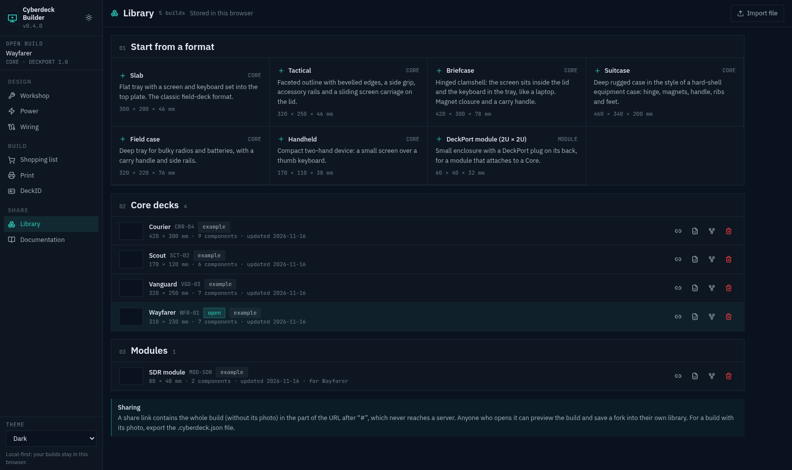
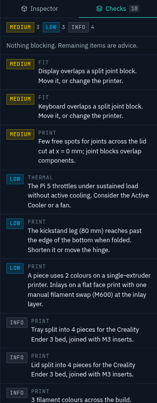
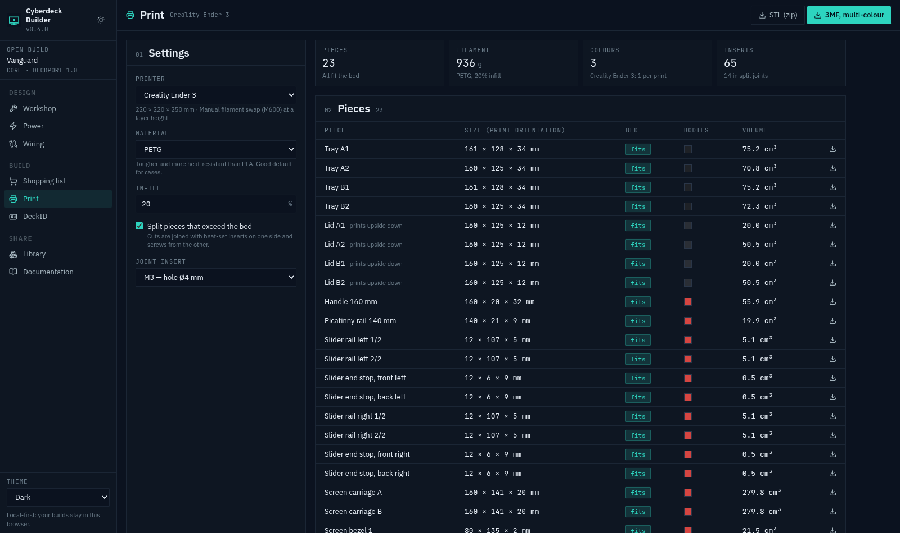
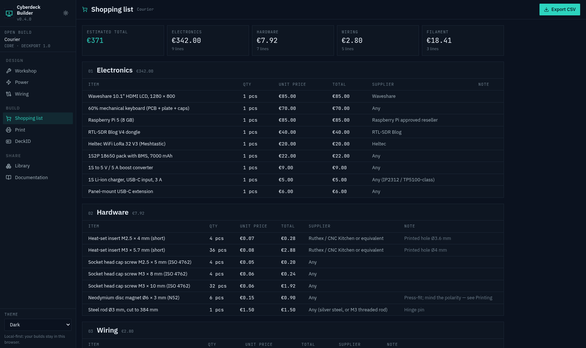
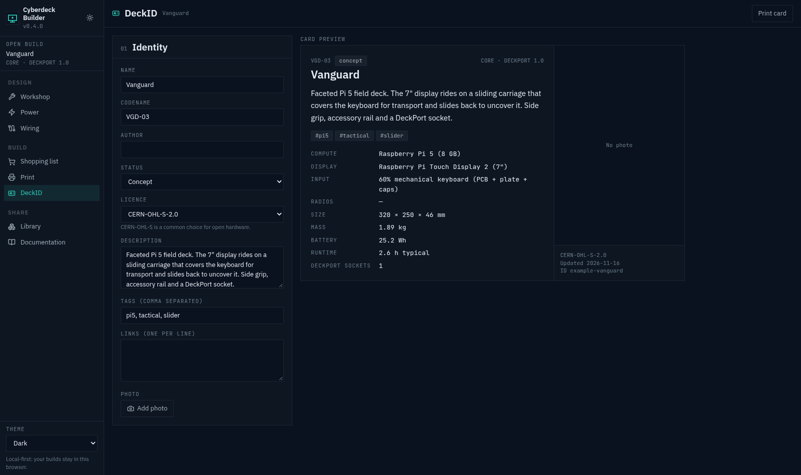

# Getting started

## 1. Pick a format

Open **Library** and choose a format under *Start from a format*:

Seven formats are available: Slab, Tactical, Briefcase, Suitcase, Field case, Handheld and DeckPort module. See [Formats](./formats.md) for pictures of each one.

The library also ships five examples: **Wayfarer** (Pi 5 slab), **Vanguard** (tactical deck with a sliding screen), **Courier** (briefcase), **Scout** (handheld) and **SDR module**.

## 2. Place components

In the **Workshop**, the *Components* tab lists the catalog. Click a component to add it: displays go into the lid, everything else into the tray. Then:

- pick the **Move** tool (M) and drag its arrows along X, Y or Z, or drag the box on its plane (hold **Shift** to snap to 5 mm),
- pick the **Rotate** tool (R) and drag a ring to turn it in 90° steps,
- or nudge it with the **arrow keys** (Shift for 10 mm),
- or type exact values in the **Inspector**.

Components that collide or stick out of the case get a red outline, and the **Checks** tab tells you why.

## 3. Shape the case

Select *Case & build settings* in the **Outline** tab to change dimensions, wall thickness, corner radius, closure screws and colours. Add vents, holes, pads or colour inlays from **Outline → Geometry → +**, and rails, handles, feet, DeckPort sockets or a screen slider from **Outline → Accessories → +**. See [Case geometry](./case-geometry.md) and [Accessories](./accessories.md).

## 4. Check power and wiring

**Power** shows whether your converters can carry the load and how long the battery lasts. **Wiring** draws the connections. See [Power](./power.md) and [Wiring](./wiring.md).

## 5. Print and buy

Choose your printer on **Print**. Parts larger than the bed are split automatically and joined with heat-set inserts. Export a **3MF** (multi-colour) or a zip of **STL** files. The **Shopping list** counts every insert, screw, magnet and hinge pin the case needs.

## 6. Give it an identity

The **DeckID** page is the deck's identity card: codename, author, licence, description, photo and computed specs.

## Keyboard shortcuts

| Keys | Action |
|---|---|
| Ctrl + Z / Ctrl + Shift + Z | Undo / redo |
| Arrow keys (+ Shift) | Nudge the selected component by 1 mm (10 mm) |
| V / M / R | Select, Move or Rotate tool |
| Delete | Remove the selected component, feature or accessory |
