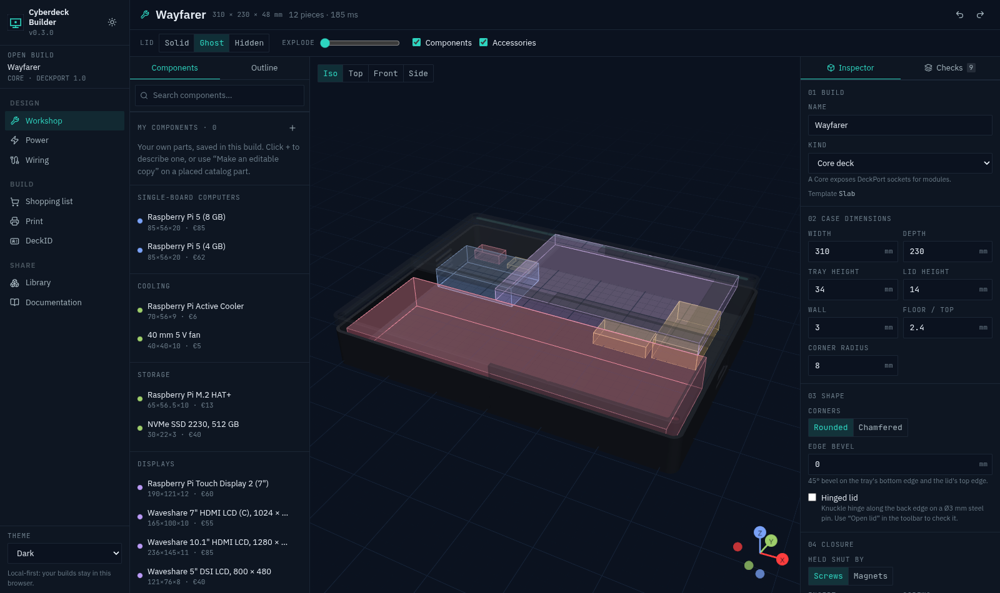
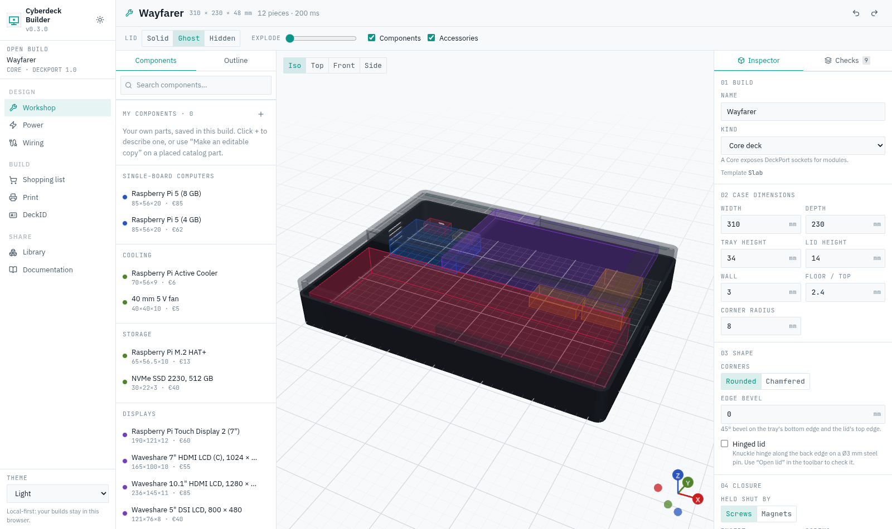

# Overview

**Cyberdeck Builder** is a web app for designing modular cyberdecks, from the electronics to the printed case. You place real components, shape the case with simple modelling operations, check that everything fits and is powered, then export printable files and a shopping list.

It is **local-first**: builds live in your browser (IndexedDB). Nothing is uploaded. Builds travel as `.cyberdeck.json` files or as share links that carry the whole build in the URL.

## What you can do

| Page | Purpose |
|---|---|
| **Workshop** | Place components in 3D, edit the case, add geometry features and accessories, review checks. |
| **Power** | Per-rail budget, converter headroom, battery draw, autonomy and charge time. |
| **Wiring** | Power, data and signal diagram derived from the build, editable by hand. |
| **Shopping list** | Electronics, heat-set inserts, screws, wire and filament, with CSV export. |
| **Print** | Printer profile, bed-fit splitting with insert joints, multi-colour 3MF and STL export. |
| **DeckID** | The identity card of a deck: codename, author, licence, photo and computed specs. |
| **Library** | Your builds, formats to start from, import, export, share links and forks. |

## The modular idea

Every deck is either a **Core** or a **Module**. A Core exposes **DeckPort** sockets; a Module carries a DeckPort plug. DeckPort fixes the mechanics (four M3 inserts on a 2U × 1U footprint), the electrics (5 V, USB 2.0, I²C, ID) and the logic (a versioned spec). A module you design next year bolts onto the Core you print today. See [DeckPort](./deckport.md) and [Modules](./modules.md).

## Start here

1. [Getting started](./getting-started.md): a first deck in ten minutes.
2. [Formats](./formats.md): slab, tactical, briefcase, suitcase and more.
3. [Case geometry](./case-geometry.md): how the case is generated and how to shape it.
4. [Accessories](./accessories.md): how to place Picatinny rails, handles and feet.
5. [Screen slider](./slider.md): a display that slides over the keyboard.
6. [Printing](./printing.md): inserts, split joints and multi-colour.

## Light and dark

The sun / moon button next to the app name switches between light and dark. Under **Theme** at the bottom of the sidebar, *Follow the system* tracks your operating system's setting, and the GitHub palettes are also available.

