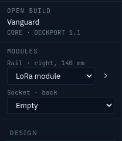
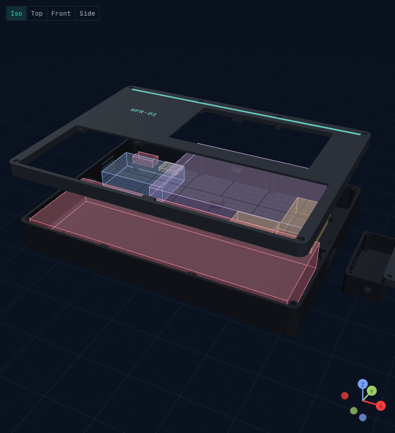

# Modules

## The idea

A cyberdeck here is split in two:

- the **Core**: the deck itself, with the computer, screen, keyboard, battery and power supply. You print and assemble it once.
- **modules**: small add-on cases, each with one job (an SDR, a LoRa radio, a GPS, a macro pad, a second battery). They take power and data from the Core and can be swapped.

They meet at **mounting points** on the Core. There are two kinds:

| Mounting point on the Core | Matching side on the module | How it holds | How it connects |
|---|---|---|---|
| **DeckPort socket** | DeckPort **plug** | Key in a recess, 4 × M3 screws | Through the socket itself: 8-pin **pogo**, or **USB-C** |
| **Picatinny rail** | **Rail clamp** | Slides on, M4 cross bolt in a slot | A short **USB-C cable** to a port beside the rail |

The rules (power, pinout, dimensions) are in the [DeckPort specification](./deckport.md). Because they are fixed and versioned, a module you design in a year fits the Core you print today.

## Connecting a module to a Core

1. Have both builds in your library: the Core, and a module whose plug matches the mounting point (socket or rail, same connector).
2. Open the **Core**. In the sidebar, under **Modules**, every mounting point is listed with a menu: pick the module. The menu only offers modules that fit.
3. The module appears mounted in the viewport, its draw is added to the Core's 5 V budget on the **Power** page, and the **Checks** tab confirms it fits.

The same choice is available in the Inspector when you select the socket or rail (Outline → Accessories). That is also where you set a rail module's **position along the rail** and the **USB-C port** beside the rail.

To edit a module, click the **›** next to it in the sidebar. When the open build is a module, the sidebar shows **how it mounts** and the Cores it is on, with a button to go back.

Toggle **Modules** in the toolbar to hide mounted modules. **Explode** pulls them away from their mounting point. The module's pieces are not part of the Core's Print page or Shopping list: print and buy them from the module's own build.

## Designing a module

1. **Library → Start from a format**:
   - **DeckPort module (2U × 2U)** for a socket module: plug on its back, pogo by default.
   - **Rail module (Picatinny)** for a rail module: clamp on its bottom, USB-C port on its end.
2. Select its **DeckPort** accessory to choose **Mounts**: *On a socket* or *On a Picatinny rail*. For a socket module, also choose the **Connector**: *8-pin pogo* or *USB-C*.
3. Place its electronics. Its 5 V loads are powered by the Core through VBUS, so it needs no converter; USB and I²C devices take their port from the plug.
4. The Checks list warns when the module draws more than 15 W, has no plug, or when a rail clamp is too big for its face.

## Making a Core ready for modules

- **Sockets**: Outline → Accessories → **+ → DeckPort**, on any face. Choose pogo or USB-C in its Inspector.
- **Rails**: Outline → Accessories → **+ → Picatinny rail** (see [Accessories](./accessories.md)), then in its Inspector set **USB-C port beside the rail**: *Above* or *Below* it, or *Past the left / right end* when the face is too short for a port beside the rail.

Each one with a module takes one of the Core's USB ports (add a hub if the port check complains), gets a VBUS feed on the Wiring page, and adds its connector to the Shopping list.

## Going USB-C everywhere

To use only USB-C between Core and modules:

- give every **socket** on the Core the **USB-C** connector, and every **socket module** a **USB-C** plug;
- or use **rails** with a **port**: rail modules always connect with a USB-C cable.

What USB-C gives you: off-the-shelf connectors and cables, a reversible plug, the same 15 W and USB 2.0 data. What it drops compared with the pogo block: the **I²C bus** (unless you wire SBU1/SBU2 with full-featured cables), the **ID pin** (modules identify themselves over USB instead) and **VBAT**. Fit receptacles with the CC resistors: 10 kΩ pull-up on the Core side, 5.1 kΩ pull-down on the module side.

## The examples

| Core | Module | Mounting |
|---|---|---|
| Wayfarer | SDR module | Socket, 8-pin pogo |
| Courier | GPS module | Socket, USB-C |
| Vanguard | LoRa module | Picatinny rail, USB-C cable to the port past the rail end |
