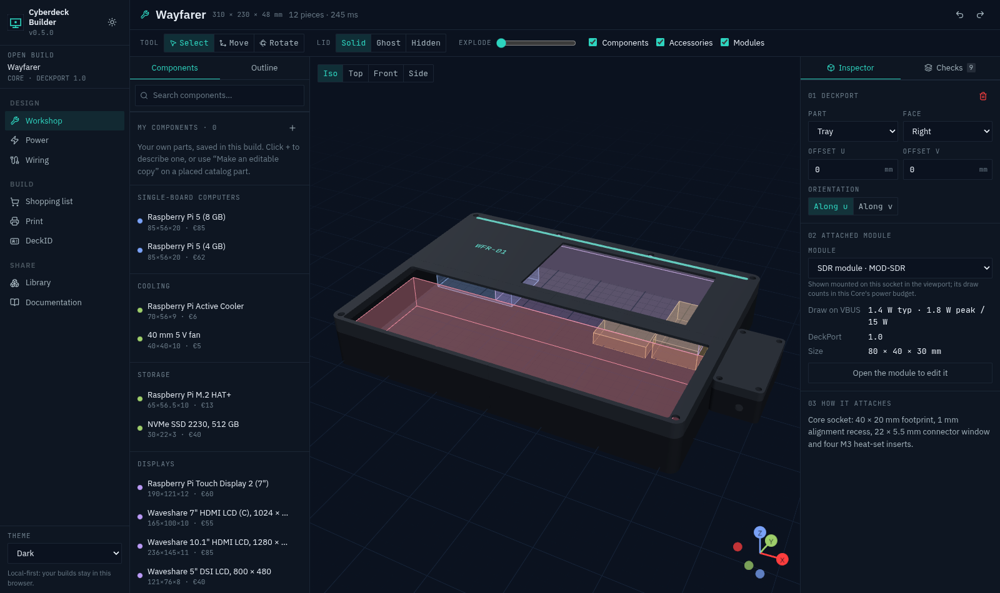

# Modules

A module is a small enclosure that plugs into a Core through a DeckPort socket: an SDR, a LoRa radio, a GPS, a second battery, a macro pad.

## Designing a module

1. **Library → DeckPort module (2U × 2U)** creates a module build. It starts with a DeckPort plug on its back face.
2. Place its electronics in the Workshop as usual.
3. Module loads on 5 V are powered from the Core through **VBUS**, so no converter is needed. USB and I²C devices take their port from the plug.
4. The Checks list warns when the module draws more than 15 W, or when the plug is missing.
5. Fill in its **DeckID**. Optionally note which Core it was designed for.

## Adding a socket to a Core

Add a **DeckPort** accessory to any face of the Core (Outline → Accessories → +). The Core gets the alignment recess, the connector window and four M3 inserts. Each socket:

- needs one free USB port on the Core (port check),
- gets a VBUS wire from the Core's 5 V converter on the Wiring page,
- adds a DeckPort connector to the Shopping list.

## Attaching a module to a Core

Once a module exists in your library, mount it on a socket of your Core:

1. Open the Core and select its **DeckPort** accessory (Outline → Accessories).
2. Under **Attached module**, pick the module.

From then on:

- the module is drawn **mounted on the socket**, plug face against socket face, and follows the lid if the socket is on a hinged lid. Toggle **Modules** in the toolbar to hide it. **Explode** pulls it away from the socket;
- its draw (the sum of its loads) is a **load on the Core's 5 V rail** in the Power page, so the Core's converter and battery life account for it;
- the Checks list warns when the module peaks above the socket's **15 W**, or implements a different **major DeckPort version** than the Core;
- the Core's DeckID lists its modules.

The module stays its own build: **Open the module to edit it** switches to it, and the Core picks up the change. The module's pieces are not part of the Core's Print page or Shopping list; print and buy them from the module's own build.

## Workflow: build the Core now, modules later

Print and assemble your Core with one or two sockets. Months later, design a module against DeckPort 1.0: it fits without touching the Core. Keep each module as its own build in the library, and link it to its Core in the DeckID.
