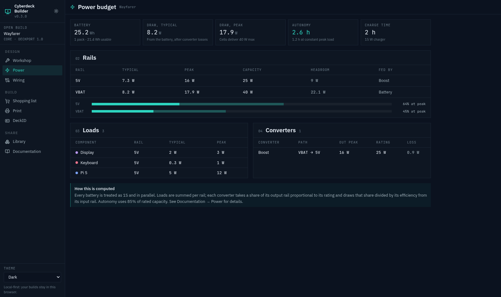

# Power

## Model

- **Loads** draw a typical and a peak power from a rail: `5V`, `3V3`, `12V` or `VBAT`.
- **Converters** move power from one rail to another with an efficiency, up to a rating.
- **Batteries** are treated as **1S and in parallel**, the common cyberdeck setup. Their energies add up, and so does their maximum discharge power.
- **Chargers** refill the batteries.

The rails are resolved from the lowest voltage up: `3V3`, then `5V`, then `12V`, then `VBAT`. When several converters feed one rail, each takes a share proportional to its rating. Each converter's input is its output divided by its efficiency, plus its quiescent draw, and that input is added to the rail feeding it. Whatever reaches `VBAT` is drawn from the battery.

Small 3.3 V loads with no regulator of their own are fed from the SBC's regulator, through the GPIO 3.3 V pin.

## Numbers

| Value | How |
|---|---|
| Autonomy | usable energy ÷ typical draw. Usable energy is 85% of rated capacity. |
| Autonomy at peak | usable energy ÷ peak draw: the worst case. |
| Charge time | capacity ÷ (charger power × 0.85) |

## Raspberry Pi 5 specifics

The Pi 5 asks for **5 V / 5 A (27 W)**. On a smaller supply it limits USB peripherals to **600 mA in total**. When the build's 5 V capacity is below 25 W, the Checks list flags it. Size the boost converter for 25 W, or accept the USB limit.

## Wire gauge

Each derived power wire gets a gauge from its peak current:

| Current | AWG |
|---|---|
| ≤ 0.5 A | 28 |
| ≤ 1 A | 26 |
| ≤ 2 A | 24 |
| ≤ 3.5 A | 22 |
| ≤ 5 A | 20 |
| ≤ 7.5 A | 18 |
| ≤ 10 A | 16 |

These are conservative values for short runs inside a warm enclosure. Silicone-insulated wire is recommended.

## Safety

Lithium cells store a lot of energy. Use protected cells or a pack with a BMS, buy from reputable vendors (no "9900 mAh 18650"), fuse the battery output, and leave room for pouch cells to swell.
