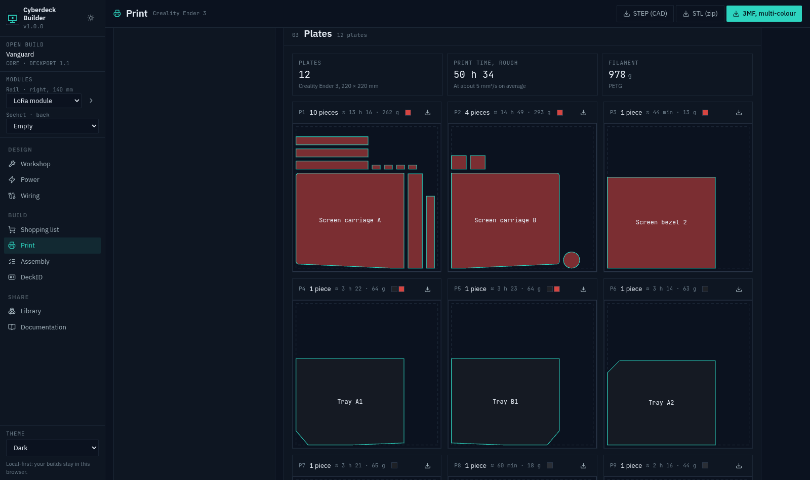

# Printing

## Printer profiles

| Printer | Usable bed | Colours per print |
|---|---|---|
| Creality Ender 3 / V3 | 220 × 220 × 250 mm | 1 (manual M600 swap) |
| Bambu Lab A1 | 256 × 256 × 256 mm | 4 (AMS lite) |
| Bambu Lab A1 mini | 180 × 180 × 180 mm | 4 (AMS lite) |
| Bambu Lab P1S / X1C | 256 × 256 × 256 mm | 4 (AMS) |
| Prusa MK4 / CORE One | 250 × 210 / 250 × 220 mm | 1 (MMU3: 5) |

A 5 mm safety margin is taken off each edge of the bed before checking the fit.

## Plates and print time

The **Plates** panel on the Print page lays every piece out on your printer's bed. Pieces go largest first, in rows, and a piece is turned 90° when that is the only way it fits. Each plate is drawn from above with its pieces' real outlines.



For each plate you get the piece count, the colours, a filament weight and a **rough print time**. The time comes from the volume and an average flow for the printer (5 mm³/s for an Ender 3, 11 for an A1, 13 for a P1S / X1C), plus a little for each colour change. A slicer gives the real figure; this one tells you whether it is an evening or a weekend.

The download button on each plate exports a **3MF of that plate, laid out as shown**, ready to slice.

## STEP export for CAD

**STEP (CAD)** on the Print page writes every piece as a named solid, in assembled position, in one `.step` file (AP214). It opens in FreeCAD, Fusion 360, Onshape or SolidWorks, where you can measure, cut, fillet or add your own features.

The solids are **faceted**: coplanar triangles are merged into flat faces with their holes, so walls and plates are single faces, but curved surfaces (rounded corners, the knurled grip) stay as many small flat faces. It is a mesh-accurate solid, not a parametric model. A build with a knurled grip gives a large file (around 20 MB).

## Heat-set inserts

The case is held together with brass heat-set inserts, never by screwing into bare plastic. The rule is the same everywhere: **one side receives the insert, the other side gets a clearance hole, and the screw is driven from that far side**, so it clamps the two parts together.

| Size | Printed hole | Hole depth | Boss | Clearance | Head counterbore |
|---|---|---|---|---|---|
| M2 | Ø3.2 | 4.0 | Ø5.5 | Ø2.4 | Ø4.2 × 2.2 |
| M2.5 | Ø3.6 | 5.0 | Ø6.0 | Ø2.9 | Ø5.0 × 2.7 |
| M3 | Ø4.0 | 6.7 | Ø8.0 | Ø3.4 | Ø6.0 × 3.4 |
| M4 | Ø5.6 | 9.1 | Ø10.0 | Ø4.5 | Ø7.6 × 4.4 |

The values suit short inserts of the Ruthex / CNC Kitchen kind. If your printer prints holes tight, the inserts will crack the boss; widen *holeD* in `src/domain/hardware.ts` by 0.1–0.2 mm.

**Installing:** about 220 °C for PLA and 240 °C for PETG, with a dedicated insert tip. Press straight down, stop flush and let it cool before loading it.

## Bed-fit splitting

When *Split pieces that exceed the bed* is on, a part larger than the bed is cut into the smallest grid of pieces that fits: 2 × 1, then 2 × 2, and so on up to 4 × 4. Pieces are named by column letter and row number (Tray A1, Tray B1…).

Every cut gets **joint blocks** that are fused to the shell before cutting:

```
          cut plane
              │
  ┌───────────┼───────────────┐
  │  screw ◄══╪══ insert      │
  │  head     │               │
  └───────────┼───────────────┘
   5 mm block │  8 mm block
   (clearance)│  (heat-set insert from the cut face)
```

- The block on the **+ side** of the cut gets a heat-set insert pressed in from the cut face.
- The block on the **− side** gets a clearance hole. The screw head sits on its inner face, inside the case, where a hex key can reach it.
- Blocks go against both walls, then along the floor (tray) or the ceiling (lid), roughly every 70 mm.
- **Blocks avoid components.** Candidate spots that would collide with a placed component are skipped. If fewer than two spots are free, the wall blocks are forced in and the Checks list says so.

Joint screws are counted on the Shopping list. Change the joint insert size on the Print page.

## Multi-colour

Colour comes from three places:

- the **tray**, **lid** and **accessory** colours (Inspector → Colours),
- **extrude** features whose colour differs from their part,
- **inlay** features.

Each colour becomes a separate **body** of the piece.

### 3MF export

The 3MF holds every piece as one object made of one part per colour, with a base material per colour. In Bambu Studio or OrcaSlicer, answer **Yes** when asked to load it as a single object with multiple parts, then assign a filament per part. PrusaSlicer imports the parts the same way.

### Single-extruder printers (Ender 3)

Lids print **upside down**, top surface on the bed, so an inlay on the lid top prints in the first layers. Slice the lid, find the layer where the inlay ends (0.6 mm by default) and insert a **filament change (M600)** there. Bodies at the same height cannot be split across colours without a multi-material printer.

### STL export

A zip with one STL per body, named `piece-n-colour.stl`, in print orientation.

## Magnets and hinge pins

- **Magnets** (Ø6 × 3 mm, N52) press into their pockets. Add a drop of CA glue if they are loose. **Mind the polarity**: stack two magnets, mark the outward face of each, and fit the tray magnets with one face out and the lid magnets with the opposite face out, so they attract.
- **Hinge pin**: Ø3 mm silver steel rod or M3 threaded rod, cut to the length on the Shopping list. Push it through the knuckles once the tray and lid are printed (and joined, if they were split). A drop of glue in the two end knuckles keeps it in place.

## Print orientation

| Piece | Orientation |
|---|---|
| Tray | Floor on the bed, open side up |
| Lid | Top plate on the bed |
| Rails, handles, feet | Mounting face on the bed |
| Screen carriage | Channels down; the pocket opens upward |
| Screen bezel | Flat |
