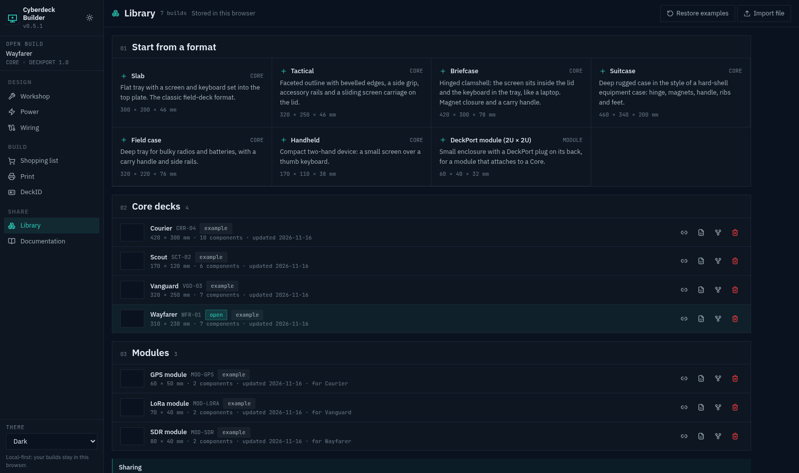

# Sharing & library

## Local-first

Builds are stored in this browser's **IndexedDB**. Nothing leaves your machine unless you export it. Clearing site data deletes your builds, so export the ones you care about.

## Ways to share

| Method | Contains | Best for |
|---|---|---|
| **Share link** | The whole build except its photo, compressed into the part of the URL after `#` | Chat, forums, issues |
| **.cyberdeck.json** | The whole build, including the photo | Archiving, Git, large builds |

The part of a URL after `#` is **never sent to a web server**, so a share link works the same on GitHub Pages, a custom domain or a local copy of the app.

Opening a share link shows a preview. **Save a copy to my library** creates a **fork**: a new build that records where it came from (`forkedFrom`), so the original is never overwritten.

## Library

- **Start from a format** creates a new build from a case template.
- **Fork** copies any build.
- **Delete** removes a build from this browser only. It asks for a second click, because the build exists nowhere else unless you exported it.
- **Restore examples** puts back any example build missing from the library, in its original version. Examples you kept, and your own builds, are not touched. To get a fresh copy of an example you changed, rename or fork yours first, delete the example, then restore it.

## File format

A `.cyberdeck.json` file is a single JSON object validated by the schema in `src/domain/schema.ts`. It carries a `schemaVersion`; older files are migrated when they are loaded (`src/domain/migrate.ts`). The format is plain and stable enough to diff in Git.
