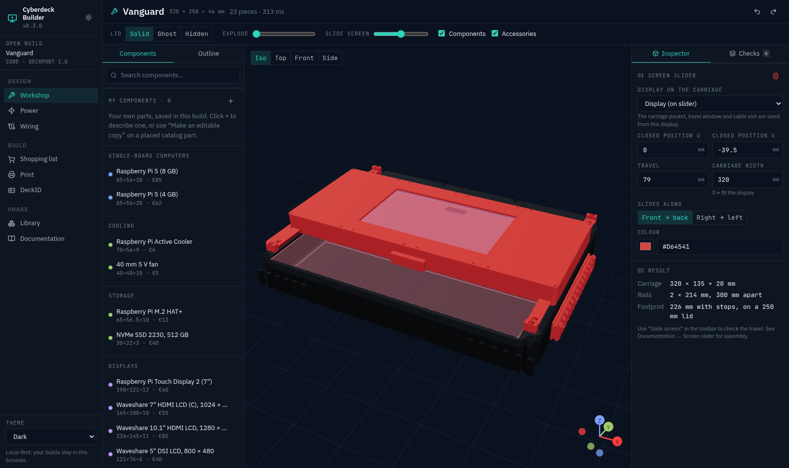
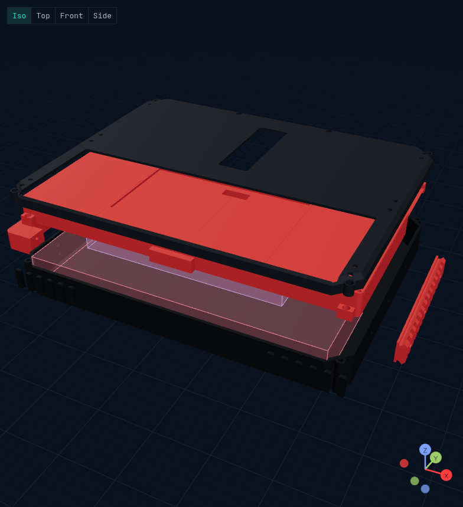

# Screen slider

A screen slider mounts the display on a **carriage** that slides on two dovetail **rails** bolted to the lid top. Closed, the screen covers the keyboard for transport; open, it slides back and uncovers it. The Tactical format and the **Vanguard** example use one.

## Adding one

1. Place a display. Its category does not matter, as long as it is a display.
2. **Outline → Accessories → + → Screen slider.** The first display in the build is assigned automatically.
3. In the Inspector:
   - **Display on the carriage**: the display it holds. The carriage pocket, the bezel window and the cable slot are sized from it. That display no longer gets standoffs or a window in the lid, and the case-fit check ignores it.
   - **Closed position u / v**: where the carriage centre sits when closed.
   - **Travel**: how far it slides towards the back.
   - **Carriage width**: 0 sizes it to the display. A wider carriage puts the rails further apart, outside a keyboard window in the lid; Vanguard uses the full 320 mm lid width.
   - **Slides along**: front to back, or right to left.
4. Move **Slide screen** in the toolbar to check the travel. The **Result** section lists the carriage size, the rail length and the footprint with stops. The Checks tab warns when the rails run past the lid.

## What gets generated

| Piece | Description |
|---|---|
| **Slider rails** (2) | Dovetail bars, 8 mm wide at the lid and 12 mm at the top, 5 mm tall. Each one is screwed to the lid with M3 screws into heat-set inserts. Longer than the bed? It is split into segments with their own screws. |
| **End stops** (4) | Small blocks, one beyond each end of each rail, each held by one M3 screw. They set the closed and open positions. |
| **Screen carriage** | A tray with the display pocket on top and two dovetail channels underneath, with 0.3 mm of side clearance. It rides on the rail tops, 0.6 mm above the lid. It has a finger pull on the front and a cable slot at the back. |
| **Screen bezel** | A 2 mm frame with a window over the display's active area, screwed to the carriage with M2.5 screws into inserts. It holds the display in. |
| **Lid cable slot** | A 30 mm slot through the lid as long as the travel, so the display cable follows the carriage into the case. |

### Wider than the bed

A carriage wider than the bed is split into pieces, and the bezel is split with **staggered seams**: the bezel bridges every carriage seam, the carriage bridges every bezel seam, and screws into inserts on both sides of each seam lock the stack into one rigid part. On an Ender 3, Vanguard's 320 mm carriage prints as 2 carriage pieces and 3 bezel pieces.

## Assembly

1. Press the M3 inserts into the lid bosses (rails and stops), and the M2.5 inserts into the carriage wall tops.
2. Screw the **rails** to the lid.
3. Put the display in the carriage pocket, route its cable through the carriage slot and the lid slot, and screw the **bezel** on.
4. Slide the carriage onto the rails from the front.
5. Screw on the four **end stops**.

Print the carriage **channels down**: the dovetail flanks are steep enough to print without supports, and the 13 mm channel ceilings bridge cleanly. Rails print base down. If the slide is stiff, sand the rail flanks lightly or rub them with dry PTFE lubricant. If it rattles, print the rails at 101% width.

## Cable

A display ribbon (DSI) or a thin HDMI cable needs a **service loop** at least as long as the travel inside the case. Fix it to the lid at the slot's front end so it rolls rather than kinks.
