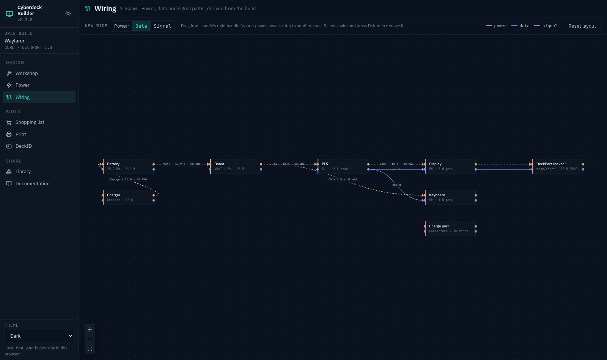

# Wiring

The Wiring page draws the deck as a block diagram. Nodes are placed components, plus DeckPort sockets on a Core or the plug on a module.

## Derived wires

The app works out the obvious connections from the build:

| Wire | From → to |
|---|---|
| Power | Battery → every converter fed from VBAT |
| Power | Charger → every battery |
| Power | Converter → every load on its output rail (with several converters on one rail, the loads go to the first) |
| Power | 5 V converter → each DeckPort socket (VBUS) |
| Data | Port provider → consumer, assigned greedily: the SBC's own ports first, then hubs |
| Signal | I²C and GPIO connections |

Power wires are labelled with their rail, their peak power and a suggested gauge (see [Power](./power.md)).

## Editing

- **Move** nodes by dragging. Positions are saved in the build.
- **Delete** a wire: select it and press Delete. A derived wire stays deleted even when the build changes.
- **Draw** a wire: pick *Power*, *Data* or *Signal* under *New wire*, then drag from a node's right handle to another node. Each node has two handles per side: the upper one is for power, the lower one for data and signal.
- **Reset layout** restores the automatic layout and every deleted derived wire.

The diagram is logical, not a schematic: it shows what connects to what and how much current flows, not pin-level connections.
