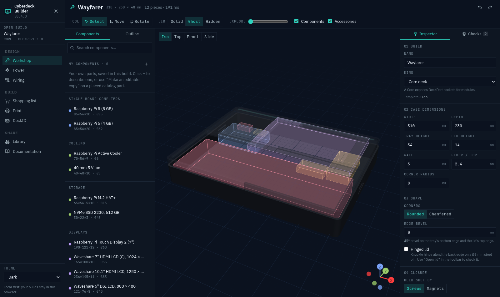
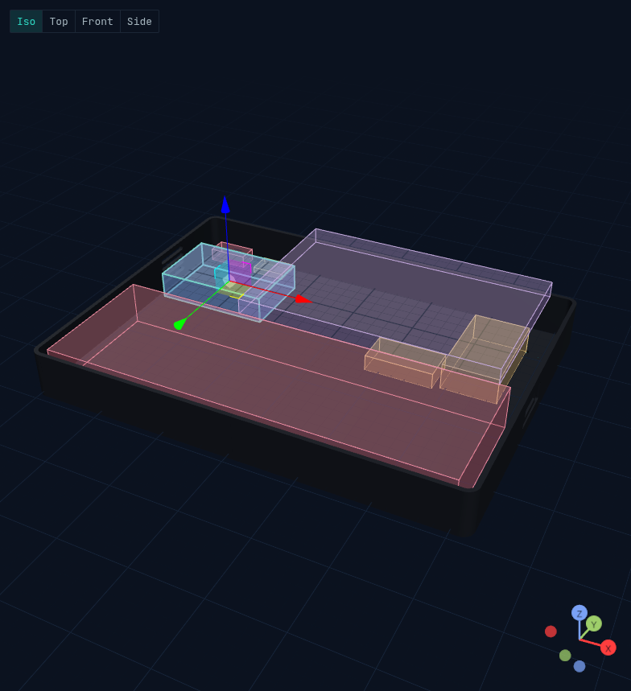
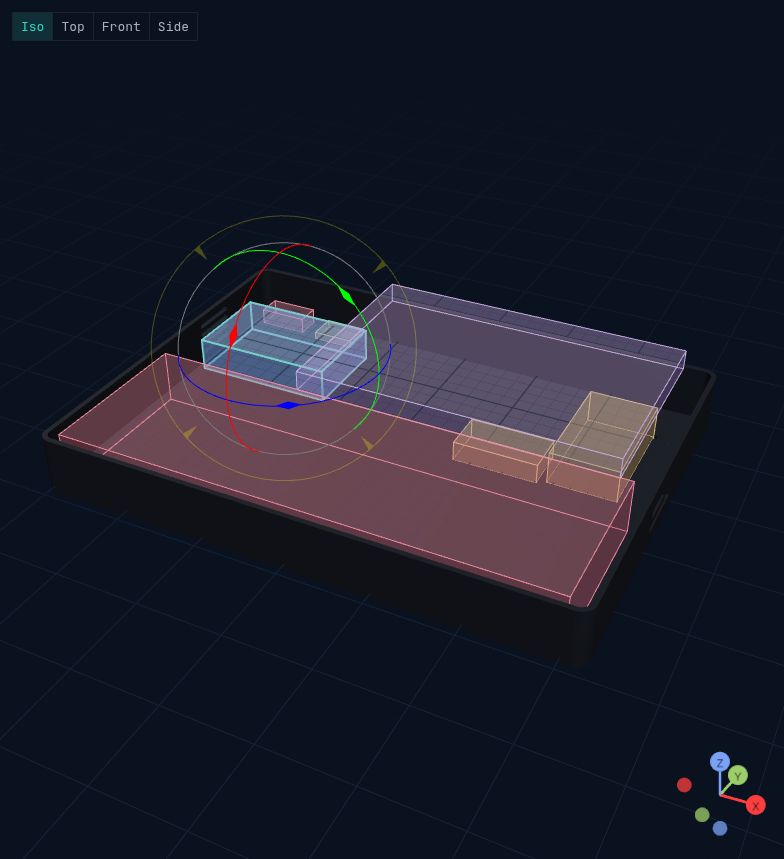

# Workshop

The Workshop has three columns.

### Left rail

- **Components**: the catalog, grouped by category and searchable. A coloured dot marks each category; the same colour is used in the viewport and the wiring diagram.
- **Outline**: everything in the build: the case, placed components, geometry features and accessories. Click an item to select it.

### Viewport

- **Lid**: *Solid*, *Ghost* (transparent, the default) or *Hidden*.
- **Explode**: lifts the lid and pushes accessories out along their faces.
- **Open lid** (hinged cases only): swings the lid on its hinge, from 0 to 120°.
- **Slide screen** (with a screen slider only): moves the carriage from closed to fully open.
- **Components / Accessories**: toggle their visibility.
- Orbit with the left mouse button, pan with the right, zoom with the wheel. Click empty space to select the case.

Components are drawn as their envelope boxes. A selected component is outlined in the accent colour, and a colliding one in red. Hover over a component to see its name, size and position in the bottom-left corner.

The **Iso / Top / Front / Side** buttons in the top-left corner of the viewport set the camera. Click the active one again to reset the view after orbiting.

### Tools: Select, Move, Rotate

The **Tool** buttons at the left of the toolbar decide what the mouse does to components.

| Tool | Key | What it does |
|---|---|---|
| **Select** | V or Esc | Click a component to select it. Nothing moves, so you can inspect without nudging anything by accident. |
| **Move** | M | The selected component shows three arrows: red **X** (left/right), green **Y** (front/back), blue **Z** (up/down). Drag an arrow to move along that axis only, in 1 mm steps. You can also drag the box itself to slide it on its horizontal plane (Shift snaps to 5 mm). |
| **Rotate** | R | The selected component shows three rings. Drag a ring to turn it about that axis, in 90° steps: **Z** turns it flat on the floor, **X** and **Y** stand it on an edge. |

Each drag is one undo step, written when you release the mouse. Moving along Z changes *Lift above floor* (tray) or *Drop below top* (lid). The component stays in its part; change *Mounted in* in the Inspector to move it between the tray and the lid.

A component turned about X or Y is **tilted**: it gets no standoffs, because its mounting holes no longer face the floor. Its windows follow it, though: a screen stood up facing forward gets its opening cut in the front wall. The Inspector shows the three angles with a button to step each one by 90°.

Components in a lid that is open on its hinge, and displays carried by a screen slider, cannot be dragged. Close the lid, or move the slider in its own inspector.

### Right rail

- **Inspector**: edits the selection.
- **Checks**: every problem with the build, ranked by severity.

## Severities

The scale is Remora's:

| Severity | Meaning |
|---|---|
| Critical | The build cannot work as designed: a component outside the case, a missing rail, a piece larger than the bed. |
| High | Likely to fail: overloaded converter, collision, missing ports. |
| Medium | Worth fixing: no ventilation, joint blocks under components. |
| Low | Advice. |
| Info | Context, such as how many pieces were split. |

## Coordinates

Millimetres. The origin is the centre of the case footprint, on the floor. **+X** is right, **+Y** is towards the back and **+Z** is up. The front face is −Y.

For a component in the tray, *Lift above floor* raises it; in the lid, *Drop below top* lowers it from the inner ceiling. Rotations are in 90° steps, applied about X, then Y, then Z.
